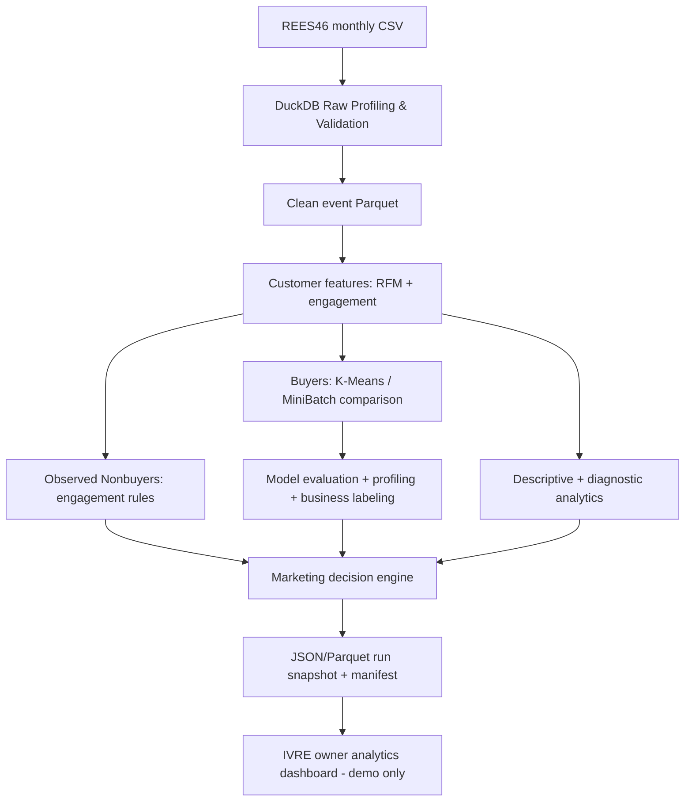

# MASTER PROJECT PLAN — CRISP-DM 21 ngày

**Tên đề tài:** Phân tích và phân khúc khách hàng dựa trên hành vi mua sắm và tương tác website nhằm hỗ trợ ra quyết định marketing trong thương mại điện tử.

**Nguồn chân lý:** tài liệu này cho scope/gates/architecture; `configs/kpi_dictionary.yaml` cho các định nghĩa KPI; `PROJECT_STATUS.md` cho sự thật tiến độ; số liệu thực nghiệm chỉ lấy từ run logs/CSV/JSON xác minh được.

## A. Business scope và non-goals

### Mục tiêu nghiệp vụ

- **O1 — Understand:** định lượng hành vi mua và tương tác website theo user/session/event và theo thời gian.
- **O2 — Segment:** xây cụm buyers từ RFM + Engagement, so sánh feature sets, kiểm tra chất lượng, ổn định, ý nghĩa kinh doanh; non-buyers phân nhóm qua engagement rules.
- **O3 — Support decisions:** chọn mục tiêu và chiến thuật marketing dựa trên evidence của từng cohort/segment/customer, kèm reason codes, eligibility, KPI cần đo và cảnh báo giới hạn.

**Không hứa hẹn:** uplift doanh thu, ROI, xác suất thành công marketing, xác suất churn có giám sát, tối ưu ngân sách thực tế nếu không có dữ liệu treatment/control/campaign cost và kết quả.

**In scope:** Python batch ETL + DuckDB/Parquet, pandas trên customer table, scikit-learn K-Means, rule-based strategy, JSON snapshot, IVRE React demo, 2 báo cáo, benchmark time/RSS.

**Out of scope:** production tracking/customer identity reconciliation/marketing email execution/FashionStore DB migrations/real-time services/campaign causal modeling/GMM bắt buộc.

## B. Dữ liệu và tính trung thực

**Primary:** REES46 Cosmetics events (Oct 2019–Feb 2020) — https://www.kaggle.com/datasets/mkechinov/ecommerce-events-history-in-cosmetics-shop. Chỉ dùng theo điều khoản nguồn, ghi attribution. Dữ liệu cosmetics không đại diện chắc chắn fashion IVRE.

**Event schema dự kiến:** `event_time` UTC, `event_type` view/cart/remove_from_cart/purchase, `product_id`, `category_id`, `category_code`, `brand`, `price`, `user_id`, `user_session`. **P1 phải xác minh schema thật**. Không có order_id, campaign treatment, email consent, gross margin, refund data.

**Unit/grain:** raw event 1 row/event; distinct user `(source,user_id)`; session `(source,user_id,user_session)` tránh collisions; purchase-session proxy 1 session có ≥1 purchase event, trong cùng session có thể nhiều purchase lines. `Monetary` = sum `price` purchase events (không suy số lượng/đơn/currency chưa xác thực).

**Temporal split:** Observation `[2019-10-01T00:00:00Z, 2020-02-01T00:00:00Z)`; February holdout `[2020-02-01T00:00:00Z, 2020-03-01T00:00:00Z)`. Không dùng holdout để feature engineering/fit hoặc chọn hyperparameters nếu muốn giữ kiểm chứng độc lập.

**Buyer:** ≥1 purchase trong observation. **Observed nonbuyer:** có event nhưng chưa có purchase trong observation; không suy lifetime never bought. Không cho `RFM recency=999` giả tạo.

## C. Architecture (decoupled)

### KPI & feature windows

- F/M buyer: entire observation; R: days since last observed purchase until cutoff.
- Recent engagement: `[T-30d,T)` and previous `[T-60d,T-30d)`; optional historical counts with clearly defined window.
- `activity_ratio=(sessions_recent+1)/(sessions_previous+1)`; activity delta; keep recent absolute count. Smooth pseudocount not evidence of true 1:1 activity when both zero.
- Unit test grain and boundary with synthetic data before EDA.

## D. Lịch 21 ngày, deliverable, phase gate

| Phase | Ngày | CRISP-DM | Kỹ thuật/việc cần làm | Gate/Output |
|---|---|---|---|---|
| P0 | 1–2 | Business Understanding | Objectives, question→metric→decision map, scope, KPI dictionary, H1–H5, risks, performance requirements | KPI contract unambiguous; toy tests pass; docs ready |
| P1 | 3–4 | Data Understanding | REES46 load 5 tháng, DuckDB data profile, event, user/session, missing, distribution, first EDA | Row counts & schema verified; quality report+EDA; no invented claims |
| P2 | 5–7 | Data Preparation | Timestamp/schema validation; duplicate audit; missing/price/outlier policies; raw→clean Parquet; cutoff split | Reconciliation counts, clean schema, no future leakage, processing benchmarks |
| P3 | 8–10 | Data Preparation + Explore | Buyer RFM purchase-session proxies, nonbuyer engagement, funnel/cohort, 30d vs previous, distribution, transformations | Feature tests manually validated; feature table reproducible; benchmark |
| P4 | 11–13 | Modeling | Feature sets F0 RFM, F1 RFM+engagement; scale/log ablation; K=2..8; K-Means and optional MiniBatchKMeans | Fit + internal metrics + runtime/RSS; save artifacts/seed/preprocessor |
| P5 | 14–15 | Evaluation | Silhouette/DBI, stability ARI, original units profile, February future behavior once, mapping business labels, optional shallow surrogate tree | Tradeoff matrix + business interpretation, future report, limits |
| P6 | 16–17 | Evaluation/Deployment | Evidence detection, goals, tactic catalog, eligibility/suppression, priority reasoning, KPI, recommendation explainability, rule unit tests | Reason traceable to feature, coverage/consistency/conflict tests |
| P7 | 18–19 | Deployment | Export overview/funnel/segments/customers/strategies/model metrics/manifest JSON, React IVRE demo (independent), responsive check | JSON schema validated, source label REES46, dashboard real run metrics |
| P8 | 20–21 | Review | Reproducibility and regression tests, time/RSS performance, document final results and limitations, prepare defense | End-to-end verification & complete 2 docs |

Không đóng phase chỉ vì đã viết code. Dữ liệu, tests, metrics, actual runtime và docs phải đi cùng.

## E. Feature sets & modeling contract

- `F0`: buyers RFM with justified transforms and scaling.
- `F1`: F0 + recent engagement (select few nonredundant features).
- `F2` optional: F1 + previous-window engagement/trends, only if adds interpretability or business value with acceptable ETL cost.
- K-Means chính, MiniBatchKMeans đối chiếu tốc độ khi hợp lý; RFM Rule-Based baseline marketing; GMM/UMAP/SHAP optional.
- K=2..8 **search range**, not predetermined final K. Multiple random seeds (configured); save actual inputs and timing.
- Metrics: Silhouette fixed sample and dimensions explicitly noted, DBI, inertia, relative stability via ARI (same feature representation), segment sizes, original-unit medians, future return/purchase differences.
- Caution: Silhouette F0 vs F1 computed in different geometries; compare conditionally and supplement with human interpretability, future outcomes, runtime. Surrogate fidelity only tells how closely decision tree reproduces K-Means, NOT correctness of clustering.

## F. Marketing Decision Support protocol

**Input:** buyer segment and profile or nonbuyer engagement group, baseline stats from all users, current behavior windows, data_quality, coverage eligibility. **Output:** business goal, candidates, rank, evidence, reason codes, conditional channel, KPI, constraints, `NOT_VALIDATED` status.

**Candidate tactic catalog**: Loyalty, Early Access, Post-Purchase Education, Re-engagement, Product Education, Cart Recovery Support, Low-Cost Nurturing, No Action. Match based on measured behavior and explicit rules; no causal claims, no fake ROI. Lack of contact preferences means email is *hypothetical channel* only.

**Validation:** rule unit tests, conflict/suppression, consistency, coverage, traceability from reason to raw feature, independent business rubric when possible; actual campaign A/B future work.

## G. Performance & model selection

**Measure:** time.perf_counter() per stage and end-to-end; sampled process RSS via psutil, baseline RSS + observed peak; throughput records/s or customers/s, input/output size, Python/OS/CPU/threads/library versions. Never use tracemalloc as total DuckDB memory. Benchmark in fresh process for fair comparison; repeats, median & variation. `DuckDB memory_limit` does NOT cap all native memory nor machine RSS; configure per machine.

**Decision rule:** correctness/leakage/reproducibility are *hard gates*; collect **multi-dimensional trade-off matrix** (quality, future validation, stability, interpretability, runtime, RSS). No arbitrary single weighted accuracy score; identify dominated options, then justify operational choice. Example SLA (5 min etc) remains TBD until machine benchmark; don't present it as verified or academically universal.

**Do not falsely assert:** more dimensions always decrease silhouette; MiniBatch always faster; UMAP plots reflect exact high-dimensional separation; tree can perfectly explain K-Means.

## H. Reporting & evidence

- Exactly two living prose docs: `reports/DATA_ANALYTICS_REPORT.md` with scientific chapters + system design + results; `reports/TECHNICAL_LEARNING_NOTES.md` for What/Why/How/Formula/Example/Alternatives/Tests/Limits/Defense.
- Machine run artifacts: `outputs/experiments/*.csv/*.json` + final JSON + manifest, generated by scripts, not manually fabricated.
- After every phase update `PROJECT_STATUS.md`: completed/blocked, real commands run, pass counts, metrics artifact paths, assumptions and next phase.
- Four label classes for assertions: **Verified in dataset**, **Design/assumption**, **Illustrative toy**, **Pending verification**. When unsure, mark as pending.

## I. Research questions / hypotheses

- H1: buyer behaviors can be grouped into interpretable, nontrivial RFM segments. Test internal metrics & profiles.
- H2: engagement adds materially distinct behavior to RFM. Compare F0/F1 on comparable cohorts, business profiles & future outcomes (not naive silhouette comparison).
- H3: engaged nonbuyers contain distinct browse/cart behavior; test session funnel and count distributions. Do not infer cause.
- H4: some buyer segments differ in February return/purchase indicators. Compare holdout outcomes without using them to tune.
- H5: explainable tactics can be recommended from segment evidence and validated business rules; test rule correctness/coverage/reviewer agreement, NOT causal lift.

## J. References

- REES46: https://www.kaggle.com/datasets/mkechinov/ecommerce-events-history-in-cosmetics-shop
- CRISP-DM overview: https://www.ibm.com/think/topics/crisp-dm
- DuckDB Parquet: https://duckdb.org/docs/stable/data/parquet/overview
- scikit-learn clustering: https://scikit-learn.org/stable/modules/clustering.html
- scikit-learn silhouette: https://scikit-learn.org/stable/modules/generated/sklearn.metrics.silhouette_score.html
- scikit-learn MiniBatch: https://scikit-learn.org/stable/modules/generated/sklearn.cluster.MiniBatchKMeans.html
